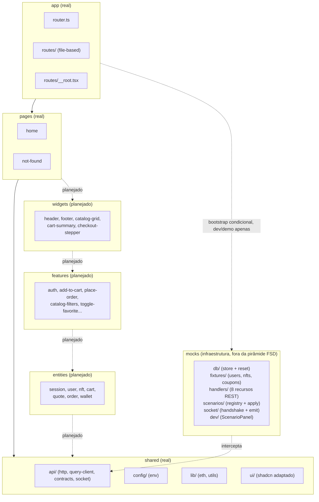

# Arquitetura — Kurio NFT Marketplace

> **Estado atual.** A API simulada (MSW) está completa: handlers REST para sessão/conta, NFTs, favoritos, carrinho, cotação, pedidos, perfil e carteiras, todos validados por contratos zod compartilhados, mais um motor de 9 cenários reproduzíveis e emissão real de eventos de negócio (`nft.updated`, `order.updated`) via `socket.io-client`/`@mswjs/socket.io-binding`. Este documento descreve com precisão o que já existe no código hoje e marca como "planejado" o que está no roadmap mas ainda não foi implementado. Decisões futuras devem ser registradas aqui antes de contradizer o que está escrito.
>
> **Nota de desatualização.** A frase a seguir, mantida de uma rodada anterior, não reflete mais o código: `entities/`, `features/` e `widgets/` já existem e estão em uso (ex.: `entities/nft`, `entities/session`, `features/add-to-cart`, `features/toggle-favorite`, `widgets/nft-detail-tabs`, `widgets/nft-gallery`, `widgets/related-nfts`, entre outros). A seção "Visão geral" e o diagrama Mermaid abaixo ainda descrevem essas camadas como "planejado"/vazias — não é objetivo desta rodada corrigir o diagrama inteiro, só registrar aqui que ele está desatualizado nesse ponto.

## Visão geral (Feature-Sliced Design)

Camadas: `app → pages → widgets → features → entities → shared`. Uma camada só importa das camadas abaixo dela. `src/mocks/` é infraestrutura de simulação e nunca é importada por código de negócio (`app`, `pages`, `widgets`, `features`, `entities`, `shared`), exceto pelo bootstrap condicional em `src/main.tsx`.

Hoje, as camadas implementadas são `app`, `pages` e `shared`. `widgets`, `features` e `entities` ainda não existem — mas a API simulada que eles vão consumir (REST + eventos) já está pronta.



## Estrutura real em `src/`

| Caminho                                                            | Conteúdo                                                                                                                                                                                                                                                                                                                                                                                                                                                                                                                                                                                                              |
| ------------------------------------------------------------------ | --------------------------------------------------------------------------------------------------------------------------------------------------------------------------------------------------------------------------------------------------------------------------------------------------------------------------------------------------------------------------------------------------------------------------------------------------------------------------------------------------------------------------------------------------------------------------------------------------------------------- |
| `app/router.ts`                                                    | `createRouter` do TanStack Router com `routeTree.gen.ts`, contexto `{ queryClient }`, `defaultPreload: 'intent'`, `scrollRestoration: true`.                                                                                                                                                                                                                                                                                                                                                                                                                                                                          |
| `app/routes/__root.tsx`                                            | Rota raiz (`createRootRouteWithContext<{ queryClient }>`), `notFoundComponent` global apontando para `pages/not-found`.                                                                                                                                                                                                                                                                                                                                                                                                                                                                                               |
| `app/routes/index.tsx`                                             | Rota `/`, renderiza `pages/home`.                                                                                                                                                                                                                                                                                                                                                                                                                                                                                                                                                                                     |
| `app/routeTree.gen.ts`                                             | Gerado pelo `@tanstack/router-plugin` a partir de `app/routes/`. Não editar manualmente.                                                                                                                                                                                                                                                                                                                                                                                                                                                                                                                              |
| `pages/home`                                                       | Página inicial: `useQuery` chamando `GET /api/health` via Axios.                                                                                                                                                                                                                                                                                                                                                                                                                                                                                                                                                      |
| `pages/not-found`                                                  | Página de 404 global.                                                                                                                                                                                                                                                                                                                                                                                                                                                                                                                                                                                                 |
| `shared/api/http.ts`                                               | Instância única do Axios (`baseURL: env.apiUrl`, `timeout: 10_000`). Interceptor de request injeta `Authorization: Bearer <token>` (via `setAccessToken`, estado em memória do módulo). Interceptor de response normaliza erros que batam com `apiErrorSchema` em `ApiError` (`code`/`status`/`fields`); em `code === 'UNAUTHORIZED'` limpa o token e dispara `window.dispatchEvent(new CustomEvent('session:expired'))` — hoje escutado por `SessionExpiryListener` (`src/app/model/SessionExpiryListener.tsx`), que encerra a sessão, avisa o usuário e redireciona para `/login` (ver seção "Política de sessão"). |
| `shared/api/query-client.ts`                                       | `QueryClient` com `staleTime: 30_000`, `refetchOnWindowFocus: false`, `retry: 1` (queries), `retry: false` (mutations).                                                                                                                                                                                                                                                                                                                                                                                                                                                                                               |
| `shared/api/socket/client.ts`                                      | Instância única do `socket.io-client`, `autoConnect: false`, `transports: ['websocket']`. Ainda não é conectada por nenhuma tela em produção — nenhum código de `app`/`pages` chama `socket.connect()` ou emite `identify` hoje (planejado junto das entidades/features de tempo real).                                                                                                                                                                                                                                                                                                                               |
| `shared/api/contracts/*`                                           | Schemas zod + tipos inferidos por recurso: `common`, `error`, `session`, `nft`, `favorite`, `cart`, `quote`, `order`, `profile`, `wallet`, `events`. Única fonte de verdade de request/response, usada hoje pelos handlers MSW (que validam o que devolvem via `schema.parse`).                                                                                                                                                                                                                                                                                                                                       |
| `shared/config/env.ts`                                             | Leitura tipada de `import.meta.env` (`VITE_API_URL`, `VITE_SOCKET_URL`, `VITE_ENABLE_MOCKS`).                                                                                                                                                                                                                                                                                                                                                                                                                                                                                                                         |
| `shared/lib/utils.ts`                                              | Utilitário `cn` (merge de classes).                                                                                                                                                                                                                                                                                                                                                                                                                                                                                                                                                                                   |
| `shared/ui/*`                                                      | Componentes shadcn/ui adaptados (button, badge, checkbox, dialog, input, label, radio-group, select, separator, sheet, skeleton, slider, sonner, tabs, textarea).                                                                                                                                                                                                                                                                                                                                                                                                                                                     |
| `mocks/browser.ts`                                                 | `setupWorker(...restHandlers, ...socketHandlers)`.                                                                                                                                                                                                                                                                                                                                                                                                                                                                                                                                                                    |
| `mocks/db/store.ts`                                                | Estado único (`users`, `sessions`, `nfts`, `favorites`, `carts`, `orders`, `idempotencyKeys`, `profiles`, `wallets`), persistido em `localStorage` (chave `kurio-mocks-db`, com fallback em memória fora do browser) e `reset()`.                                                                                                                                                                                                                                                                                                                                                                                     |
| `mocks/fixtures/*`                                                 | `users.ts` (2 usuários fixos, senha em texto só na fixture), `nfts.ts` (40 NFTs determinísticos via `withSeed(42, ...)`), `coupons.ts` (`KURIO10` válido 10%, `KURIO-EXPIRED` expirado 15%).                                                                                                                                                                                                                                                                                                                                                                                                                          |
| `mocks/handlers/index.ts`                                          | `GET /api/health` + os 8 grupos de handlers (`auth`, `nft`, `favorite`, `cart`, `quote`, `order`, `profile`, `wallet`), reunidos em `restHandlers`.                                                                                                                                                                                                                                                                                                                                                                                                                                                                   |
| `mocks/handlers/session.ts`, `error-response.ts`, `nft-summary.ts` | Helpers compartilhados: sessão a partir do header `Authorization`, envelope de erro (`apiErrorSchema`) e cálculo de `favorited` por sessão.                                                                                                                                                                                                                                                                                                                                                                                                                                                                           |
| `mocks/scenarios/*`                                                | Motor de cenários: `registry.ts` (9 cenários + leitura de query param/`localStorage`), `apply.ts` (`withScenario` para latência/offline, `matchOverride` para erros determinísticos por rota).                                                                                                                                                                                                                                                                                                                                                                                                                        |
| `mocks/socket/index.ts`                                            | Handler do handshake Socket.IO via `@mswjs/socket.io-binding` (detalhado abaixo).                                                                                                                                                                                                                                                                                                                                                                                                                                                                                                                                     |
| `mocks/socket/emit.ts`                                             | Registro de emissores por conexão e as funções `emitNftUpdated`/`emitOrderUpdated`, chamadas pelos handlers de pedido.                                                                                                                                                                                                                                                                                                                                                                                                                                                                                                |
| `mocks/dev/ScenarioPanel.tsx`, `ScenarioPanelGate.tsx`             | Painel flutuante de dev para trocar cenário e resetar o `db` (ver README).                                                                                                                                                                                                                                                                                                                                                                                                                                                                                                                                            |

## Contratos REST e eventos

Todos os contratos abaixo são schemas zod em `src/shared/api/contracts/`, usados pelos handlers MSW para validar o que devolvem (`schema.parse(...)`). Rotas sem 🔒 não exigem sessão.

### Sessão / conta (`handlers/auth.ts`)

| Método | Rota                 | 🔒  | Request                                                                             | Resposta                         | Erros                                           |
| ------ | -------------------- | --- | ----------------------------------------------------------------------------------- | -------------------------------- | ----------------------------------------------- |
| POST   | `/api/auth/login`    |     | `{ "email": "ana.colecionadora@kurio.test", "password": "Kurio@123" }`              | `200` `Session`                  | `401 UNAUTHORIZED`                              |
| POST   | `/api/auth/register` |     | `{ "username": "nova.kurio", "email": "nova@kurio.test", "password": "Senha@123" }` | `201` `Session`                  | `409 CONFLICT` (e-mail/username já cadastrados) |
| GET    | `/api/auth/session`  | 🔒  | —                                                                                   | `200` `Session`                  | `401 UNAUTHORIZED` (sem token ou expirado)      |
| POST   | `/api/auth/logout`   |     | —                                                                                   | `204` (sempre, mesmo sem sessão) | —                                               |

`Session` = `{ user: User, accessToken: string, expiresAt: ISO }`. Token expira em 30 min, checado em `getSessionFromRequest` a cada request autenticada.

### NFTs (`handlers/nft.ts`)

| Método | Rota            | 🔒  | Request                                                                                                                                                            | Resposta                           | Erros           |
| ------ | --------------- | --- | ------------------------------------------------------------------------------------------------------------------------------------------------------------------ | ---------------------------------- | --------------- |
| GET    | `/api/nfts`     |     | Query: `q`, `collections[]`, `priceMin`, `priceMax`, `network`, `tab` (`all/new/trending`), `sortBy` (`relevance/price_asc/price_desc/newest`), `page`, `pageSize` | `200` `NftListResponse` (paginado) | —               |
| GET    | `/api/nfts/:id` |     | —                                                                                                                                                                  | `200` `NftDetail`                  | `404 NOT_FOUND` |

`favorited` nunca é um campo estático do NFT: é recalculado por `toNftSummary` (`handlers/nft-summary.ts`) a partir da sessão da própria request — sem sessão, sempre `false`.

Exemplo de `NftSummary`:

```json
{
  "id": "nft_001",
  "tokenId": "#4821",
  "name": "Mystic Fox",
  "collectionId": "col_violet_nomads",
  "collectionName": "Violet Nomads",
  "image": "https://picsum.photos/seed/kurio-nft-1/600/600",
  "price": "1.19",
  "previousPrice": "1.52",
  "network": "ethereum",
  "isRare": true,
  "favorited": false,
  "available": 3
}
```

### Favoritos (`handlers/favorite.ts`) — todas as rotas 🔒

| Método | Rota                    | Request                  | Resposta                          | Erros                               |
| ------ | ----------------------- | ------------------------ | --------------------------------- | ----------------------------------- |
| GET    | `/api/favorites`        | —                        | `200` `{ "items": NftSummary[] }` | `401 UNAUTHORIZED`                  |
| POST   | `/api/favorites`        | `{ "nftId": "nft_001" }` | `201` `{ "nftId", "createdAt" }`  | `401 UNAUTHORIZED`, `404 NOT_FOUND` |
| DELETE | `/api/favorites/:nftId` | —                        | `204`                             | `401 UNAUTHORIZED`                  |

### Carrinho (`handlers/cart.ts`) — todas as rotas 🔒

| Método | Rota                     | Request                                 | Resposta                                      | Erros                                                            |
| ------ | ------------------------ | --------------------------------------- | --------------------------------------------- | ---------------------------------------------------------------- |
| GET    | `/api/cart`              | —                                       | `200` `Cart`                                  | `401 UNAUTHORIZED`                                               |
| POST   | `/api/cart/items`        | `{ "nftId": "nft_001", "quantity": 1 }` | `200` `Cart` (upsert: soma à linha existente) | `401 UNAUTHORIZED`, `404 NOT_FOUND`, `409 AVAILABILITY_CONFLICT` |
| PATCH  | `/api/cart/items/:nftId` | `{ "quantity": 2 }`                     | `200` `Cart`                                  | `401 UNAUTHORIZED`, `404 NOT_FOUND`, `409 AVAILABILITY_CONFLICT` |
| DELETE | `/api/cart/items/:nftId` | —                                       | `204`                                         | `401 UNAUTHORIZED`                                               |

Preço, nome, imagem e disponibilidade do carrinho **nunca ficam congelados**: `buildCart` busca o estado atual do catálogo a cada resposta. Linhas cujo NFT não existe mais são removidas silenciosamente (do `db` e da resposta).

### Cotação (`handlers/quote.ts`) — não exige sessão

| Método | Rota         | Request                                                                                                 | Resposta      | Erros                                                                                                                                                                                                                |
| ------ | ------------ | ------------------------------------------------------------------------------------------------------- | ------------- | -------------------------------------------------------------------------------------------------------------------------------------------------------------------------------------------------------------------- |
| POST   | `/api/quote` | `{ "items": [{ "nftId": "nft_001", "quantity": 1 }], "couponCode": "KURIO10" }` (`couponCode` opcional) | `200` `Quote` | `422 COUPON_INVALID` / `422 COUPON_EXPIRED` só via override de cenário (ver tabela de cenários); sem cenário ativo, cupom desconhecido vira `couponStatus: "invalid"` dentro de uma resposta `200`, não um erro HTTP |

Exemplo de resposta:

```json
{
  "items": [
    {
      "nftId": "nft_001",
      "quantity": 1,
      "unitPrice": "1.19",
      "subtotal": "1.19",
      "availability": "ok"
    }
  ],
  "subtotal": "1.19",
  "discount": "0.119",
  "networkFee": "0.01",
  "total": "1.081",
  "couponCode": "KURIO10",
  "couponStatus": "applied",
  "quotedAt": "2026-11-03T12:00:00.000Z"
}
```

Taxa de rede fixa (`"0.01"`), todo cálculo via `big.js` (`mulEth`, `sumEth`, `subEth`, `addEth`), nunca `Number`/`parseFloat`.

### Pedidos (`handlers/order.ts`) — todas as rotas 🔒

| Método | Rota              | Headers                         | Request                                                                                                                          | Resposta      | Erros                                                                                                                                                                                                                                                                                    |
| ------ | ----------------- | ------------------------------- | -------------------------------------------------------------------------------------------------------------------------------- | ------------- | ---------------------------------------------------------------------------------------------------------------------------------------------------------------------------------------------------------------------------------------------------------------------------------------- |
| POST   | `/api/orders`     | `Idempotency-Key` (obrigatório) | `{ "items": [{ "nftId": "nft_001", "quantity": 1 }], "couponCode": "KURIO10", "walletAddress": "0x...", "network": "ethereum" }` | `201` `Order` | `401 UNAUTHORIZED`, `400 VALIDATION_ERROR` (header ausente), `409 CONFLICT` (chave reusada por outro usuário ou com corpo diferente), `404 NOT_FOUND`, `409 AVAILABILITY_CONFLICT`, `422 COUPON_INVALID`/`422 COUPON_EXPIRED`, `409 QUOTE_CHANGED` (override do cenário `quote-changed`) |
| GET    | `/api/orders/:id` | —                               | —                                                                                                                                | `200` `Order` | `401 UNAUTHORIZED`, `404 NOT_FOUND`                                                                                                                                                                                                                                                      |

Idempotência (header, não campo do body): mesma `Idempotency-Key` + mesmo corpo (hash comparado) → retorna o pedido já criado (`201` de novo, mesmo payload). Mesma chave + corpo diferente, **ou** chave já usada por outro `userId` → `409 CONFLICT` — nunca vaza pedido de uma conta para outra.

O pedido sempre nasce `pending` na resposta do `POST` (nunca `confirmed`/`declined` sincronamente). A transição é assíncrona, resolvida ~1.2s depois dentro do próprio handler (`resolveOrder` em `handlers/order.ts`, simulando o processamento do pagamento) e entregue via `order.updated` — nunca inferida pelo cliente a partir da resposta REST. No cenário `order-timeout` essa transição nunca é agendada: o pedido fica `pending` para sempre, de propósito.

Estoque: `nft.available` só é decrementado dentro de `resolveOrder`, quando o pedido de fato vira `confirmed` — nunca na criação. Pedidos `pending` (cenário `order-timeout`) ou `declined` (cenário `payment-declined`) nunca tocam o catálogo.

Exemplo de `Order` confirmado:

```json
{
  "id": "a1b2c3d4-...",
  "idempotencyKey": "checkout-a1b2c3d4",
  "status": "confirmed",
  "items": [
    {
      "nftId": "nft_001",
      "tokenId": "#4821",
      "name": "Mystic Fox",
      "image": "...",
      "unitPrice": "1.19",
      "quantity": 1,
      "subtotal": "1.19"
    }
  ],
  "subtotal": "1.19",
  "discount": "0.119",
  "networkFee": "0.01",
  "total": "1.081",
  "walletAddress": "0x1234...abcd",
  "network": "ethereum",
  "transactionId": "f0e1d2c3-...",
  "declineReason": null,
  "createdAt": "2026-11-03T12:00:00.000Z",
  "confirmedAt": "2026-11-03T12:00:00.100Z"
}
```

### Perfil (`handlers/profile.ts`) — todas as rotas 🔒

| Método | Rota                    | Request                                                                     | Resposta     | Erros                                                                                   |
| ------ | ----------------------- | --------------------------------------------------------------------------- | ------------ | --------------------------------------------------------------------------------------- |
| GET    | `/api/profile`          | —                                                                           | `200` `User` | `401 UNAUTHORIZED`                                                                      |
| PATCH  | `/api/profile`          | `{ "displayName"?, "username"?, "email"?, "avatarUrl"? }` (todos opcionais) | `200` `User` | `401 UNAUTHORIZED`, `409 CONFLICT` (e-mail/username já usado por outro usuário)         |
| PATCH  | `/api/profile/password` | `{ "currentPassword", "newPassword" }`                                      | `204`        | `401 UNAUTHORIZED` (sem sessão **ou** senha atual incorreta — mesma semântica do login) |

### Carteiras (`handlers/wallet.ts`) — todas as rotas 🔒

| Método | Rota               | Request                                                                                                | Resposta         | Erros                                                            |
| ------ | ------------------ | ------------------------------------------------------------------------------------------------------ | ---------------- | ---------------------------------------------------------------- |
| GET    | `/api/wallets`     | —                                                                                                      | `200` `Wallet[]` | `401 UNAUTHORIZED`                                               |
| POST   | `/api/wallets`     | `{ "type": "primary", "provider": "metamask", "address": "0x...", "network": "ethereum", "ensName"? }` | `201` `Wallet`   | `401 UNAUTHORIZED`, `409 CONFLICT` (já existe carteira primária) |
| PATCH  | `/api/wallets/:id` | Parcial de `CreateWalletRequest`                                                                       | `200` `Wallet`   | `401 UNAUTHORIZED`, `404 NOT_FOUND`, `409 CONFLICT`              |

### Health check (sem contrato zod)

| Método | Rota          | Resposta | Exemplo              |
| ------ | ------------- | -------- | -------------------- |
| GET    | `/api/health` | `200 OK` | `{ "status": "ok" }` |

### Enum de erro (`contracts/error.ts`)

`apiErrorCodeSchema`: `VALIDATION_ERROR`, `UNAUTHORIZED`, `FORBIDDEN` (declarado, nenhum handler emite hoje), `NOT_FOUND`, `AVAILABILITY_CONFLICT`, `CONFLICT`, `COUPON_INVALID`, `COUPON_EXPIRED`, `QUOTE_CHANGED`, `TRANSIENT` (declarado, reservado para falhas transitórias — nenhum handler emite hoje). Envelope: `{ "error": { "code", "message", "fields"? } }`.

## Eventos de Socket.IO (`contracts/events.ts`)

União discriminada por `type`, envelope comum `{ eventId, version, occurredAt }`:

| Evento          | Visibilidade                                                                                         | `resource`              | Campos extra                         | Emitido por                                                                                                                                                         |
| --------------- | ---------------------------------------------------------------------------------------------------- | ----------------------- | ------------------------------------ | ------------------------------------------------------------------------------------------------------------------------------------------------------------------- |
| `nft.updated`   | **Pública** — broadcast para toda conexão aberta                                                     | `{ type: "nft", id }`   | `data: Omit<NftDetail, "favorited">` | `handlers/order.ts` (`resolveOrder`), quando o pedido assíncrono vira `confirmed`, uma vez por item do pedido (NFT já com `available` decrementado)                 |
| `order.updated` | **Privada** — só conexão(ões) identificadas com o `userId` do pedido, revalidado no momento do envio | `{ type: "order", id }` | `userId`, `data: Order`              | `handlers/order.ts`: uma vez ao criar o pedido (`status: "pending"`) e outra vez em `resolveOrder`, quando a transição assíncrona (`confirmed`/`declined`) acontece |

`favorited` é removido do payload de `nft.updated` porque é um campo por usuário (`nftPublicEventDataSchema = nftDetailSchema.omit({ favorited: true })` em `contracts/events.ts`) — um evento de broadcast nunca pode carregar dado relativo a uma única conta; cada cliente resolve o próprio `favorited` via REST/cache local.

`version` é um contador global (`versionCounter` em `socket/emit.ts`), incrementado a cada emissão de **qualquer** evento — não é um contador por recurso. Uma reconciliação no cliente que descarte "versão menor ou igual à última aplicada" deve comparar por `resource.id`, nunca `version` entre recursos diferentes.

Exemplo de `order.updated`:

```json
{
  "type": "order.updated",
  "eventId": "9f8e7d6c-...",
  "version": 12,
  "occurredAt": "2026-11-03T12:00:00.150Z",
  "resource": { "type": "order", "id": "a1b2c3d4-..." },
  "userId": "user-1",
  "data": { "id": "a1b2c3d4-...", "status": "confirmed", "...": "..." }
}
```

Não existe nenhum evento de domínio além desses dois. `system.ready` (emitido ao conectar, payload `{ "at": ISO }`) é infraestrutura do mock, não um evento de negócio — usado só para verificação manual do handshake.

## Política de sessão

API simulada: login/registro emitem `{ accessToken, expiresAt }` (TTL de 30 min), `GET /api/auth/session` revalida o token no servidor, `POST /api/auth/logout` invalida a sessão no `db`. No cliente, tudo isso é consumido por `entities/session`.

### Persistência do token e revalidação

- `src/entities/session/model/token-storage.ts` persiste o `accessToken` em `localStorage` (chave `kurio-access-token`), com `get`/`set`/`clear`. É o único lugar que toca essa chave.
- `src/entities/session/model/useSession.ts` lê o token do storage para decidir o `enabled` da query `GET /api/auth/session` (`queryKeys.session()`): só revalida contra o servidor simulado quando existe token guardado, evitando um `401` certo em quem nunca logou.
- O Axios (`setAccessToken`, estado em memória do módulo `shared/api/http.ts`) precisa ser reidratado a partir do `localStorage` **fora do render**, antes de qualquer request sair. Isso é feito por `rehydrateAccessToken()` (`src/entities/session/model/session-lifecycle.ts`), chamada uma única vez no bootstrap de `src/main.tsx`, antes do router processar qualquer rota.

  Essa função existe por causa de um bug real encontrado nesta sessão: a reidratação acontecia antes dentro do corpo de `useSession()` (efeito colateral de render). Em refresh direto numa rota protegida (`/profile`), o `beforeLoad` de `src/app/routes/_authenticated.tsx` chama `fetchSession()` **antes** do primeiro render de `useSession()` — então a primeira request saía sem `Authorization`, o servidor simulado respondia `401`, e o usuário era deslogado mesmo tendo um token válido guardado. Mover a reidratação para fora do render, no bootstrap, corrige a causa raiz: quando o `beforeLoad` roda, o Axios já tem o token em memória.

### Expiração via evento global

`shared/api/http.ts` tem um interceptor de resposta do Axios que, em qualquer erro `401 UNAUTHORIZED`, chama `setAccessToken(null)` e dispara `window.dispatchEvent(new CustomEvent('session:expired'))`.

Quem escuta é `src/app/model/SessionExpiryListener.tsx`, montado em `src/main.tsx` dentro do contexto do router. Esse componente usa o par de baixo nível `RouterContextProvider` + `Matches` em vez do `RouterProvider` padrão — necessário porque `RouterProvider` não aceita `children`, e o listener precisa estar dentro do contexto do router (para usar `useRouter`/navegar) ao lado de `<Matches />`, que renderiza as rotas.

Ao receber `session:expired`, o listener:

1. Chama `endSession(queryClient)` — zera o token em memória, limpa o `tokenStorage`, desconecta o socket e limpa todo o cache do Query (`queryClient.clear()`).
2. Mostra um toast de erro ("Sua sessão expirou. Entre novamente para continuar.").
3. Redireciona para `/login`.

### Redirect preservando a rota

O listener captura `router.state.location.href` no momento exato da expiração, antes de navegar, e redireciona com `search: { redirect: current }` — assim o usuário volta exatamente para a rota em que estava (`/checkout`, `/profile` etc.) depois de logar de novo. O mesmo padrão de captura de `location.href` é usado no guard de rota autenticada (`_authenticated.tsx`, `beforeLoad`), tanto quando não há token quanto quando a sessão não revalida no servidor.

### Centralização em `session-lifecycle.ts`

`src/entities/session/model/session-lifecycle.ts` concentra três funções — `rehydrateAccessToken()`, `startSession(queryClient, session)` e `endSession(queryClient)` — como único lugar que manipula `setAccessToken`, `tokenStorage` e o cache de sessão/socket. Login, registro, logout e expiração de sessão todos delegam a essas funções em vez de duplicar a lógica ou tocar no token cru em cada feature.

### UI do logout

Ao clicar em "Sair", abre-se um modal (`src/features/logout/ui/LogoutDialog.tsx`, mesmo padrão visual do modal de login/registro) mostrando "Até mais, {nome}... realizando logout" com um loader, controlado por `logout.isPending` da mutation `useLogout` (`src/features/logout/model/useLogout.ts`). O modal fecha automaticamente quando a mutation resolve (`onSettled`: `endSession` + navegação para `/` + toast de sucesso). O delay perceptível de ~3s vem de graça do `SIMULATED_REQUEST_DELAY_MS` já existente em `http.ts` — que se aplica a toda request REST —, sem necessidade de nenhum timer artificial no logout.

### Conexão do socket por sessão

`useSession()` conecta o `socket.io-client` (`socket.auth = { token }`, `socket.emit('identify', ...)` no `connect`, `socket.connect()`) apenas quando a query de sessão confirma um `userId`, e desconecta no cleanup do efeito. `endSession` também desconecta explicitamente no logout/expiração, cobrindo o caso em que o componente que chamou `useSession` ainda não desmontou.

## Estado do carrinho (visitante → autenticado)

A API simulada já modela o carrinho como recurso do servidor por `userId` (`GET/POST/PATCH/DELETE /api/cart...`, sempre 🔒) — não existe hoje um conceito de "carrinho de visitante" no backend simulado.

Ainda **planejado** (`entities/cart`, `features/add-to-cart`, inexistentes hoje): estratégia de persistência do carrinho de visitante (ex.: `localStorage`) antes do login e sua migração/merge para `/api/cart` ao autenticar.

## Estratégia de cache, retries e sincronização

Hoje existe apenas a configuração global do `QueryClient` (`src/shared/api/query-client.ts`):

| Opção                  | Valor       | Efeito                                                                       |
| ---------------------- | ----------- | ---------------------------------------------------------------------------- |
| `staleTime`            | `30_000` ms | Dados de query são considerados frescos por 30s antes de refetch automático. |
| `refetchOnWindowFocus` | `false`     | Não refaz fetch ao focar a janela.                                           |
| `retry` (queries)      | `1`         | Uma tentativa adicional em caso de falha.                                    |
| `retry` (mutations)    | `false`     | Mutations não são retentadas automaticamente.                                |

Política detalhada por tipo de erro (não retentar 4xx, backoff em falhas transitórias, idempotência em `place-order` reaproveitando a mesma `Idempotency-Key`), query keys com `userId` e `placeholderData: keepPreviousData` em listagens — **planejado**, conforme rule `tanstack-query.md`, a partir das fases de catálogo/pedidos.

A mutation otimista de favoritos, citada como "planejado" numa rodada anterior deste documento, **já existe**: é `useToggleFavorite` (`src/features/toggle-favorite/api/toggle-favorite.ts`), consumida por `FavoriteButton` (`src/features/toggle-favorite/ui/FavoriteButton.tsx`), usado como botão sobreposto na imagem principal do widget `src/widgets/nft-gallery`. É a mutation que cumpre o requisito da rule `tanstack-query.md` ("pelo menos uma mutation — favoritos — é otimista com rollback"):

- **Requisição real**: `POST /api/favorites` com `{ "nftId": "nft_001" }` para favoritar, `DELETE /api/favorites/:nftId` para desfavoritar (handlers em `src/mocks/handlers/favorite.ts`).
- **`onMutate`**: cancela as queries em voo de `queryKeys.nfts.detail(nftId)` e `queryKeys.favorites(user.id)`, tira um snapshot do valor anterior de ambas (`previousDetail`, `previousFavorites`) e aplica o novo valor otimista via `queryClient.setQueryData` — a UI reflete a mudança (`isFavorited` no detalhe, lista de favoritos) instantaneamente, antes de qualquer resposta do servidor simulado.
- **`onError`**: desfaz para **exatamente** o snapshot capturado em `onMutate` nas duas queries — nunca um "oposto calculado" a partir do estado atual.
- **`onSettled`**: invalida as duas queries (sucesso ou falha), reconciliando com o estado real do MSW.
- Sem usuário autenticado, `onMutate` não faz nada (`if (!user) return`) — mas isso é defensivo: `FavoriteButton` já intercepta o clique antes de chamar `toggle.mutate`, redirecionando para `/login` com `search: { redirect: location.pathname }` em vez de disparar a mutation.
- Existe um cenário MSW dedicado para exercitar o rollback: `mutation-failure` (`src/mocks/scenarios/registry.ts`), que força `POST /api/favorites` e `DELETE /api/favorites/:nftId` a responderem `500 TRANSIENT`. Coberto por teste E2E em `e2e/specs/02-nft-detail.spec.ts`.

## Reconciliação REST × Socket.IO

A emissão de eventos de negócio já é real (ver seção de eventos acima): `order.updated` é emitido ao criar o pedido (`pending`) e de novo, de forma assíncrona, quando `resolveOrder` decide `confirmed`/`declined`; `nft.updated` sai junto dessa segunda emissão, a cada item de um pedido que virou `confirmed`. O que ainda não existe é o consumo no cliente — nenhum código de `app`/`pages`/`shared` assina `nft.updated`/`order.updated` hoje.

Pontos que a implementação futura (fase de tempo real) precisa respeitar, já deduzidos do contrato real:

- Dedupe por `eventId` (UUID por emissão).
- `version` é um contador **global**, não por recurso — descartar "versão menor ou igual à última aplicada" deve ser feito comparando eventos do mesmo `resource.id`, nunca `version` bruto entre `nft.updated` e `order.updated` ou entre NFTs diferentes.
- `order.updated` só chega para a conexão que já fez `identify` com o token da sessão certa (ver seção de transporte) — o cliente real vai precisar emitir `identify` após `socket.connect()`.
- Ao reconectar, invalidar/refetch dos recursos ativos (carrinho, cotação, pedido pendente, detalhe aberto) — ainda planejado, conforme rule `realtime-socket.md`.

## Transporte do Socket no MSW e limitações

O `socket.io-client` conecta por padrão em `/socket.io/...` (não na raiz do host). O handler `ws.link(...)` do MSW precisa do padrão com wildcard — `'wss://realtime.kurio.local/*'`, não `'wss://realtime.kurio.local'` sem path — porque o matcher HTTP do handshake do MSW não faz strip automático de `/socket.io/` (isso só ocorre depois do upgrade, dentro do `WebSocketHandler` interno). Sem o wildcard, a conexão nunca é reconhecida pelo MSW.

Código do handshake (`src/mocks/socket/index.ts`):

```ts
import { ws } from 'msw'
import { toSocketIo } from '@mswjs/socket.io-binding'
import { registerEmitter } from './emit'
import { getSessionByToken } from '../lib/session'

const realtime = ws.link('wss://realtime.kurio.local/*')

export const socketHandlers = [
  realtime.addEventListener('connection', (connection) => {
    const io = toSocketIo(connection)

    const { unregister, setToken } = registerEmitter((event) => {
      io.client.emit(event.type, event)
    })
    connection.client.addEventListener('close', unregister)

    // Handshake mínimo: o cliente emite `identify` com o `accessToken` da
    // sessão HTTP logo após conectar, pra esta conexão passar a receber
    // `order.updated` (dado privado).
    io.client.on('identify', (_event, payload) => {
      const token = payload?.token
      const session = typeof token === 'string' ? getSessionByToken(token) : null
      setToken(session ? session.token : null)
    })

    queueMicrotask(() => {
      io.client.emit('system.ready', { at: new Date().toISOString() })
    })
  }),
]
```

Cada conexão WebSocket registra o seu próprio emissor em `socket/emit.ts` (`registerEmitter`, mantido num `Set<RegisteredEmitter>`) — sem isso, uma segunda aba sobrescreveria a primeira. A entrada guarda o **token** (não um `userId` já resolvido), começando `null` (a conexão ainda não se identificou) e atualizado depois do handshake `identify` acima — só se `getSessionByToken` validar o token na hora.

A separação entre dado **público** e **privado** é resolvida manualmente, não pelo binding:

- `emitNftUpdated` (NFT = catálogo, dado público) itera **todas** as entradas do `Set` e emite para todas, sem filtro.
- `emitOrderUpdated(order, userId)` (pedido = dado privado) itera o `Set` e, pra cada entrada com `token` não nulo, chama `getSessionByToken(entry.token)` de novo **no momento do envio** — nunca confia num `userId` cacheado no handshake. Só emite se a sessão daquele token ainda existir e resolver pro mesmo `userId` do pedido. Isso cobre tanto token expirado entre o `identify` e o envio quanto logout (que apaga a sessão do `db` em `handlers/auth.ts`) sem que o cliente precise desconectar o socket explicitamente — a próxima emissão já não entrega mais nada pra aquela conexão.

Isso existe porque `@mswjs/socket.io-binding` não implementa rooms/namespaces nativamente (ver limitações abaixo): a filtragem por usuário que o Socket.IO real faria com uma room (`io.to(userId).emit(...)`) é reimplementada à mão em `emit.ts`, comparando `userId` por conexão.

Limitações conhecidas:

- `toSocketIo(connection)` do `@mswjs/socket.io-binding` agenda os pacotes iniciais do handshake (Engine.IO `open` + Socket.IO `connect`) de forma assíncrona via `queueMicrotask` dentro do próprio construtor. Emitir (`io.client.emit(...)`) sincronamente logo depois entrega o evento customizado antes do handshake, fora de ordem — o `socket.io-client` descarta esse pacote silenciosamente. Qualquer `emit` feito pelos handlers de mock precisa estar dentro de um `queueMicrotask` (a ordem FIFO de microtasks garante que ele rode depois do handshake).
- `msw` está fixado em `^2.15.0` (não v3), porque `@mswjs/socket.io-binding@^0.2.0` declara peer dependency `msw@^2.10.2`, incompatível com MSW v3.
- O binding não é mantido 1:1 com a API real do Socket.IO: não há suporte nativo a rooms, namespaces ou broadcast (conforme o próprio README do pacote). Por isso a filtragem por usuário em `order.updated` é manual (ver acima), e não via `io.to(room)`. Qualquer outra funcionalidade avançada de tempo real simulada deve ser testada manualmente contra esse limite.
- O handshake `identify` só é consumido pelo mock hoje — nenhum código de produto (`app`/`pages`/`entities`/`features`) chama `socket.connect()` ou emite `identify` ainda, então `order.updated` não tem, hoje, nenhum destinatário real em runtime além de testes manuais/E2E que simulem o handshake diretamente.

## Decisões de UX

> **Nota desta rodada.** O Figma MCP ficou com o rate limit esgotado (plano Starter) durante toda a implementação dos widgets de layout (`Container`, `SiteHeader`, `SiteFooter`, `BlogTeaser`, `MobileTabBar`, `AccountSidebar`) e dos primitivos de honestidade de escopo. Nenhuma medida foi confirmada pixel a pixel contra o Figma nesta leva — as decisões abaixo são fallbacks conscientes do `frontend-architect`, executados pelo `ui-dev`, documentados para validação quando o Figma MCP voltar a responder.

- Fonte única: Roboto Mono (`@fontsource/roboto-mono`), carregada localmente (pesos 400/500/700) em `src/main.tsx`. O CSS (`src/index.css`) também importa `@fontsource-variable/inter` e referencia `'Inter Variable'` como `--font-sans` alternativa — ver seção de desvios abaixo.
- Tema shadcn com `style: "base-vega"` e cores via CSS variables (`src/index.css`), nunca hex solto em componente.
- **Container universal (`Container`, `src/shared/ui/container.tsx`)**: novo token `--container-page: 1200px` em `src/index.css` (dentro de `@theme inline`, gera a utility `max-w-page`). O componente usa `box-content` para que o padding (`px-6 lg:px-8`) fique **fora** do `max-w-page`, garantindo 1200px de conteúdo útil em telas grandes. Convenção adotada para o resto do projeto:
  - `AppLayout` não aplica mais gutter/`max-w` — cada página é dona do seu `<main>` e usa `<Container>` ao redor do conteúdo centralizado (ver `pages/home/ui/HomePage.tsx`).
  - Faixas full-bleed (fundo colorido ocupando a viewport inteira, como `SiteHeader`, `SiteFooter`, `BlogTeaser`) se auto-encapsulam: o elemento externo leva só fundo/borda/padding vertical, e um `<Container>` interno cuida do gutter horizontal.
  - Widgets que não são faixa (grids, sidebars) nunca aplicam gutter próprio.
  - Nunca aninhar `Container` dentro de outro `Container`.
  - Antes dessa mudança, `SiteHeader` usava `max-w-[1200px] px-6 lg:px-8` no mesmo elemento (padding dentro do `max-w`, resultando em 1136px de conteúdo útil), enquanto `SiteFooter` já usava o padrão correto (padding fora, 1200px úteis) — a divergência foi corrigida unificando os dois em `Container`.
- **Tab bar mobile (`MobileTabBar`, `src/widgets/mobile-tab-bar/ui/MobileTabBar.tsx`)**: barra com 76px de altura (`h-[76px]`); o botão central flutuante (`size-16` = 64px, `-translate-y-1/2` a partir do topo da barra) soma ~108px de altura ocupada. `AppLayout` usa `pb-28` (112px, só `md:hidden`) no wrapper de `{children}` para o conteúdo não ficar coberto.
- **Honestidade de escopo — `NoticeLink`, `OutOfScopeLink`/`OutOfScopeButton`/`OutOfScopeInput` e `PendingLink`, em vez de `disabled` simples**: a alternativa óbvia para "esse botão não faz nada nesta demo" seria o atributo HTML `disabled`. Ela foi descartada: um elemento `disabled` sai da ordem de tabulação, não recebe foco, não é anunciado por leitor de tela com nenhum motivo — fica simplesmente ausente da navegação por teclado — e visualmente só comunica "algo quebrado", sem explicar por quê. A rule `ui-styling-a11y.md` pede o contrário: "Ações fora do escopo: visíveis, mas desabilitadas ou com aviso... Nunca simule sucesso". Por isso o padrão adotado em todo o projeto é o primitivo `NoticeLink` (`src/shared/ui/notice-link.tsx`): um `<button aria-disabled="true">` — continua focável e clicável, mas `aria-disabled` (diferente de `disabled`) não o remove da árvore de acessibilidade nem da ordem de tabulação — que ao ser clicado sempre dispara um toast (`sonner`) explicando o motivo, e carrega `aria-describedby` apontando para um `<span className="sr-only">` **irmão** do botão (não descendente — descendente faria o aviso entrar duas vezes na computação do nome acessível, via nome + descrição) com a mesma mensagem, lida pelo leitor de tela ao focar o elemento. Nunca é, portanto, nem um `disabled` puro (inacessível) nem um link/botão real que finja funcionar (simularia sucesso fora do escopo). Foco visível (`focus-visible:ring-3 ring-ring/50`) em todas as instâncias. Dois usos distintos, agora separados semanticamente:
  - `OutOfScopeLink`/`OutOfScopeButton`/`OutOfScopeInput` (`src/shared/ui/out-of-scope.tsx`), mensagem "Indisponível na demonstração", visual apagado (`opacity-70`/`cursor-not-allowed` no link): para o que é **realmente fora do escopo do desafio** (blog, newsletter, Central de ajuda, categorias de coleção, Atividade/Ofertas/Downloads/Suporte da conta, "Minha coleção", "Estúdio do criador", redes sociais do footer).
  - `PendingLink` (`src/shared/ui/pending-link.tsx`), mensagem "Disponível em breve", visual normal (sem `opacity`/`cursor-not-allowed`): para funcionalidades **obrigatórias do desafio** que ainda não foram implementadas nesta fase do roadmap — hoje usado em "Meu perfil" e "Lista de interesse" na coluna do footer, e em `AccountSidebar` nos itens "Pedidos", "Lista de interesse" e no botão "Sair".
  - **Regra de saída obrigatória**: nenhum `PendingLink` pode sobreviver até a entrega final nesses pontos (Perfil, Carteiras, Pedidos, Favoritos, Sair/logout) — são eliminatórios do desafio (fluxo principal só visual, regra eliminatória nº 2). Precisam virar operações reais (`<Link>` do TanStack Router ou mutations reais) nas fases de autenticação/conta/pedidos do roadmap. O logout em particular precisa limpar o cache privado do `QueryClient` por `userId` e desconectar o `socket.io-client` (regra eliminatória nº 4, exposição de dados entre usuários).
- `SiteHeader` importava `cn` do pacote npm `cn` (equivalente ao que `@/shared/lib/utils` reexporta, ambos sobre `clsx`+`tailwind-merge`). Corrigido para `@/shared/lib/utils`, por consistência com o resto do projeto — padronização, não correção de bug funcional.
- **Limite de 10 unidades por compra — decisão do time, não do enunciado.** `useEditionSelection` (`src/entities/nft/model/useEditionSelection.ts`, linha 15) calcula `maxQuantity` como `edition.totalSupply === null ? 10 : Math.min(edition.available, 10)`. Ou seja: mesmo numa edição "aberta" (`totalSupply: null`, sem limite real de supply) ou numa edição limitada com mais de 10 unidades disponíveis, o stepper de quantidade no painel de compra (`NftPurchasePanel`, `src/features/add-to-cart/ui/NftPurchasePanel.tsx`) trava em 10 por pedido. Essa trava não vem de `docs/challenge/README-challenge.md` nem da skill `challenge-context` — é uma decisão de escopo/UX do time, para evitar quantidades de teste absurdas (ex.: 500 unidades num único pedido) durante a demo. Registrado aqui para não ser confundido com um requisito do desafio nem "redescoberto" como bug.
- **Resumo da carteira sem card de fundo — decisão de design confirmada no Figma, não um atalho.** `CartSummary` (`src/widgets/cart-summary/ui/CartSummary.tsx`) foi auditado visualmente contra o Figma real (fileKey `TWDGE5ytlsmMSUk7jX50Hw`, node `11:1278` no desktop, `16:360` no mobile) e, de propósito, **não** usa o padrão de card (`rounded-xl border border-border bg-card p-6`) adotado em outros blocos de conteúdo do projeto (ex.: `FilterSidebar`, cards de NFT). No desktop é só tipografia direta sobre o fundo da página, largura fixa de 332px via o token `--spacing-cart-summary-width` (`src/index.css`, calculado como `1200 − 782 (tabela) − 86 (gap) = 332`). No mobile ele é um bottom sheet: `bg-card`, cantos arredondados só no topo (`rounded-t-[40px]`), sem borda. Antes desta auditoria o componente tinha sido implementado com card em ambos os breakpoints — foi corrigido para bater com o Figma. Registrado aqui para que uma tarefa futura não "corrija" isso de volta para o padrão de card por engano: a ausência de card aqui é intencional e confirmada visualmente, não uma pendência.
- **Tipografia 9–10px: nenhum aumento por legibilidade.** `design-tokens.md` define `Tiny/10 Medium` e `Tiny/9 Bold` como estilos oficiais do design system e alerta que "textos de 9–10px podem prejudicar legibilidade; se aumentar, registre no ARCHITECTURE.md". Conferido nos três usos existentes no código: a variante `tiny` de `src/shared/ui/typography.ts` usa `text-[10px]` (bate com `Tiny/10 Medium`), o badge de quantidade do carrinho no header (`src/widgets/header/ui/SiteHeader.tsx`) usa `text-[10px]`, e a pill "Carteiras compatíveis" do footer (`src/widgets/footer/ui/CompatibleWallets.tsx`) usa `text-[9px]` (bate com `Tiny/9 Bold`). Em nenhum dos três o tamanho foi aumentado além do que o Figma especifica — decisão consciente de manter os 9–10px como especificado, sem ajuste por legibilidade, até que uma revisão de acessibilidade (ex.: teste de zoom 200% ou contraste) aponte necessidade real de mudança, caso em que o ajuste deve ser registrado aqui com before/depois.

## Estados não desenhados no Figma

> **Nota de desatualização.** O parágrafo abaixo, de uma rodada anterior, dizia que nenhuma tela de negócio havia sido implementada — isso não é mais verdade: a tela de detalhe do NFT (`pages/nft-detail`) já existe. O item a seguir documenta um estado da tela de detalhe que não corresponde a uma funcionalidade real desenhada no Figma.

**"Avaliações de colecionadores" é conteúdo estático, sem CRUD real.** Na aba "Avaliações de colecionadores (N)" de `NftDetailTabs` (`src/widgets/nft-detail-tabs/ui/NftDetailTabs.tsx`), `N` vem de `nft.rating.count` — mesmo valor do campo `reviewCount` da fixture (`src/mocks/fixtures/nfts.ts`) — e a aba mostra só o resumo agregado (nota média + contagem, via `StarRating`), vindo direto da fixture/API simulada, nunca inventado no componente. Não existe lista de avaliações individuais, nem endpoint de avaliação, nem mutation de criar/editar/remover avaliação — é dado estático, deliberadamente fora do escopo funcional da demo (não uma lacuna/TODO). A ação "Ver avaliações detalhadas" usa `OutOfScopeButton` (`src/shared/ui/out-of-scope.tsx`), que dispara um toast "Indisponível na demonstração" em vez de fingir uma lista de avaliações — seguindo o mesmo padrão de honestidade de escopo descrito na seção "Decisões de UX".

## Desvios e inconsistências do Figma

> Todos os itens abaixo marcados "A confirmar" ou "Pendente de validação" são fallbacks tomados **sem acesso ao Figma MCP** (rate limit esgotado, plano Starter) e precisam ser revalidados contra o Figma assim que possível.

| Item                                                                                                                                         | Figma                                                                                                                                                                                                                                                                                                  | Implementação atual                                                                                                                                                                                                                                                                              | Status                                                                                                                                                                               |
| -------------------------------------------------------------------------------------------------------------------------------------------- | ------------------------------------------------------------------------------------------------------------------------------------------------------------------------------------------------------------------------------------------------------------------------------------------------------ | ------------------------------------------------------------------------------------------------------------------------------------------------------------------------------------------------------------------------------------------------------------------------------------------------ | ------------------------------------------------------------------------------------------------------------------------------------------------------------------------------------ |
| Cor `destructive`                                                                                                                            | Não existe variável de erro/destrutiva nos tokens do Figma (`design-tokens.md` só define ink, surface-card, surface-dark, border, border-soft, primary, text-accent, secondary, text-primary, foreground, text-secondary)                                                                              | `--destructive: #e5484d` em `src/index.css`, usando o vermelho padrão do shadcn/Radix                                                                                                                                                                                                            | Provisório — ver ADR-002                                                                                                                                                             |
| Fonte secundária (`Inter Variable`)                                                                                                          | `design-tokens.md` especifica Roboto Mono como fonte única do produto                                                                                                                                                                                                                                  | `src/index.css` importa `@fontsource-variable/inter` e define `--font-sans: 'Inter Variable', sans-serif` depois de já ter definido `--font-sans` com Roboto Mono (a segunda declaração sobrescreve a primeira dentro do mesmo bloco `@theme inline`)                                            | A confirmar — possível resíduo do template shadcn/Vite, não documentado como decisão; revisar na primeira tarefa de UI que tocar tipografia                                          |
| Glifos "W"/"C"/"D" nos círculos de destaque do footer (`SiteFooter`)                                                                         | Não há acesso confirmado ao texto original do frame (Figma MCP indisponível); uma screenshot fornecida pelo usuário mostrava esses glifos sobre os blocos hoje traduzidos como "Segurança da carteira", "Criadores em destaque" e "Alertas de lançamentos"                                             | Glifos mantidos como na screenshot (hipótese: resíduo de "Wallet"/"Creators"/"Drops" do texto original em inglês, não iniciais da tradução em português)                                                                                                                                         | Pendente de validação — confirmar com Figma quando MCP voltar                                                                                                                        |
| Largura dos parágrafos dos blocos de destaque do footer                                                                                      | Não confirmado em px/ch contra o frame                                                                                                                                                                                                                                                                 | `max-w-[23ch]` (era `max-w-[220px]`, que resultava em 3 linhas); `23ch` resulta em 4 linhas, batendo com a screenshot de referência fornecida pelo usuário                                                                                                                                       | Pendente de validação                                                                                                                                                                |
| Separador vertical entre o 3º bloco de destaque e a coluna de newsletter (`SiteFooter`)                                                      | Tema não define um token de cor amarela distinto de `--primary` (laranja); pedido do usuário por uma "barra amarela" nesse ponto sem frame confirmado                                                                                                                                                  | Separador adicionado usando `bg-primary` (laranja do tema) — nenhum token novo foi criado                                                                                                                                                                                                        | Pendente de validação — se o Figma confirmar amarelo diferente do `--primary`, criar ADR com novo token em `index.css`                                                               |
| Ícones de redes sociais do footer (`social-icons.tsx`)                                                                                       | Não extraídos do Figma (MCP indisponível)                                                                                                                                                                                                                                                              | SVGs de marca inline (Facebook/Instagram/Twitter(X)/LinkedIn/YouTube), paths de referência pública estilo Simple Icons (CC0); estilo mudou de círculo para quadrado com borda branca (`border-foreground`, sem `rounded-full`)                                                                   | Pendente de validação                                                                                                                                                                |
| "Carteiras compatíveis" do footer (`CompatibleWallets`)                                                                                      | Esperado como badges/pills (não confirmado em detalhe)                                                                                                                                                                                                                                                 | Componente único (`src/widgets/footer/ui/CompatibleWallets.tsx`), uma pill só com separadores `·`; "Coinbase Wallet" encurtado para "Coinbase" para bater com a screenshot do usuário                                                                                                            | Pendente de validação                                                                                                                                                                |
| Demais valores arbitrários do footer (`text-[17px]`, `leading-[22px]`, `text-[13px]`, `tracking-[1.4px]`, `size-[74px]`, `text-[9px]`, etc.) | Pré-existentes, não confirmados contra o Figma nesta rodada                                                                                                                                                                                                                                            | Mantidos como estavam                                                                                                                                                                                                                                                                            | Pendente de validação                                                                                                                                                                |
| `NftCardSkeleton`/`CartSummarySkeleton` — estrutura e dimensões                                                                              | O componente real (`NftCard`, `CartSummary`) ainda não existe no projeto (fases futuras do roadmap); estrutura baseada na descrição textual de `figma-frames.md` (card: imagem, nome, preço, preço riscado, badge "RARO", favoritar no mobile; resumo: cupom, subtotal, desconto, taxa de rede, total) | Skeletons expandidos sem confirmação de dimensões em px contra o Figma                                                                                                                                                                                                                           | Pendente de validação — ao criar os componentes reais em `entities/nft`/`entities/cart`, mover os skeletons pra lá no mesmo commit, revalidando a estrutura contra o componente real |
| `AccountSidebar` — item "Pedidos" e reclassificação dos demais itens                                                                         | `figma-frames.md` descreve a sidebar completa como "Meu perfil, Carteiras, Pedidos, Favoritos, Atividade ⚪, Downloads ⚪, Suporte ⚪, Sair"                                                                                                                                                           | "Dados do perfil"/"Carteiras" são itens reais (ainda sem componente de link, não navegáveis); "Pedidos" e "Lista de interesse" (Favoritos) são `PendingLink`; "Atividade"/"Ofertas"/"Arquivos baixados"/"Suporte" continuam `OutOfScopeLink` (fora do escopo do desafio); "Sair" é `PendingLink` | Em progresso — `PendingLink` precisa virar operação real nas fases de conta/pedidos                                                                                                  |
| "Minha coleção" no footer                                                                                                                    | Não consta no enunciado (`README-challenge.md`) nem em `figma-frames.md`; sem contrato REST correspondente                                                                                                                                                                                             | Mantido como `OutOfScopeLink`, por cautela, na coluna "Meu perfil" do footer                                                                                                                                                                                                                     | A confirmar — item sem fonte clara no requisito                                                                                                                                      |
| Ícone de lixeira no mobile (`CartTableMobile`, node `16:360`)                                                                                | No mockup, o ícone de lixeira aparece sobreposto ao botão "+" apenas no 3º item ("Ivory Baron") — lido como erro de edição do próprio arquivo Figma, não como um estado desenhado de propósito                                                                                                         | `src/widgets/cart-table/ui/CartTableMobile.tsx` mantém +/- e remover explícitos e acessíveis em todos os itens, igual ao padrão dos demais                                                                                                                                                       | Pendente de validação — leitura ("erro de edição" vs. "estado intencional") sem 100% de certeza; revisar quando possível                                                             |
| Botão "Continuar explorando" no mobile (`CartSummary`, bottom sheet)                                                                         | Estilo/posicionamento desse botão especificamente na variante mobile não foi confirmado contra o Figma na última auditoria — só o container do resumo (bottom sheet) foi validado                                                                                                                      | `Button variant="ghost"` dentro do `<aside>` do bottom sheet, mesmo componente usado no desktop                                                                                                                                                                                                  | Pendente de validação                                                                                                                                                                |

## Substituições de assets

`src/App.tsx`, `src/App.css` e os placeholders do template inicial do Vite (`src/assets/hero.png`, `react.svg`, `vite.svg`) foram removidos — eram boilerplate não roteado (a aplicação real renderiza `pages/home`, não `App.tsx`). Nenhuma substituição de asset de produto foi feita ainda (não há telas de catálogo/NFT implementadas); as imagens de NFT nas fixtures (`mocks/fixtures/nfts.ts`) usam placeholders de `picsum.photos` (seed determinística por índice), não assets do Figma — os assets reais serão adicionados quando as telas forem implementadas a partir do Figma.

Os ícones de redes sociais do footer (`src/widgets/footer/ui/social-icons.tsx`: `FacebookIcon`, `InstagramIcon`, `TwitterIcon`, `LinkedinIcon`, `YoutubeIcon`) são SVGs de marca inline, com paths de referência pública estilo Simple Icons (CC0) — não foram extraídos do Figma (MCP indisponível nesta rodada). Ver ADR-003.

## Ajustes de acessibilidade

Nenhum ajuste de acessibilidade específico de tela de negócio foi feito ainda (não há telas de catálogo/detalhe/carrinho/checkout). Bases já presentes no projeto:

- `eslint-plugin-jsx-a11y` ativo no `lint`.
- Tema shadcn com variáveis de foco (`--ring`) herdadas pelos componentes de `shared/ui`.

Ajustes feitos nesta rodada, nos primitivos de honestidade de escopo e nos widgets de layout:

- `NoticeLink` (base de `OutOfScopeLink`/`OutOfScopeButton`/`OutOfScopeInput`/`PendingLink`): `aria-describedby` aponta para um `<span className="sr-only">` **irmão** do elemento interativo, nunca descendente — um `<span>` dentro do `<button>` entraria duas vezes na computação do nome acessível (nome + descrição), já que o conteúdo textual do botão já é o nome. Foco visível com `focus-visible:ring-3 ring-ring/50` em todos os elementos interativos novos (`NoticeLink`, `OutOfScopeButton`, `MobileTabBar`, links do `SiteHeader`).
- `MobileTabBar`: `nav` com `aria-label="Navegação principal"`, cada item com `aria-label` descritivo, ícones com `aria-hidden="true"`, item ativo com `aria-current="page"` via `activeProps` do TanStack Router.
- `AccountSidebar`: item ativo da navegação marcado com `aria-current="page"` num elemento não interativo (`<span>`, pois ainda não há rota real); ícones com `aria-hidden="true"`.
- `SiteFooter`: cada coluna de links é um `<nav>` com `aria-label` igual ao título da coluna; campo de newsletter com `<label className="sr-only">` associado via `htmlFor`/`id`; ícones de redes sociais com `aria-hidden="true"` dentro do `OutOfScopeLink`, que já carrega o `aria-label` da rede no próprio link.

Ajustes específicos de telas de negócio (focus trap em Dialog/Sheet, `aria-live` em mutations, estados não dependentes só de cor em preço riscado/badges) serão documentados aqui conforme implementados, por `ui-dev`/`quality-auditor`.

## Dados de teste (fixtures determinísticas)

Referência rápida dos valores reais usados pelos testes e2e e no dia a dia de desenvolvimento, para quem for escrever um novo teste não precisar garimpar o código.

### Cupons (`src/mocks/fixtures/coupons.ts`)

| Código          | Desconto | Status    | Comportamento                                           |
| --------------- | -------- | --------- | ------------------------------------------------------- |
| `KURIO10`       | 10%      | `valid`   | Único cupom que aplica com sucesso.                     |
| `KURIO-EXPIRED` | 15%      | `expired` | Sempre retorna `COUPON_EXPIRED`, nunca aplica.          |
| qualquer outro  | —        | —         | Não existe na fixture; sempre retorna `COUPON_INVALID`. |

### Usuários de demonstração (`e2e/fixtures/test.ts`, `DEMO_USERS`)

| Chave         | E-mail                          | Senha       |
| ------------- | ------------------------------- | ----------- |
| `collector-a` | `ana.colecionadora@kurio.test`  | `Kurio@123` |
| `collector-b` | `bruno.colecionador@kurio.test` | `Kurio@123` |

### Fixtures de NFT determinísticas (`src/mocks/fixtures/nfts.ts`)

40 NFTs gerados deterministicamente via `faker` com seeds isoladas por etapa (`withSeed`, `src/mocks/fixtures/seed.ts`, que chama `faker.seed(n)` antes de cada bloco): `42` para os dados base (nome, preço, coleção, rede, edições...), `43` para a narrativa (`longDescription`/`royaltyInfo`) e `44` para as sequências de artwork (capa/galeria) — mesmos nomes/preços entre execuções. Qualquer chamada nova ao `faker` inserida **no meio** de um desses blocos desloca a sequência inteira do PRNG daquele bloco, mudando todos os valores gerados daí em diante dentro do mesmo `withSeed` — já aconteceu nesta sessão (ver comentário em `e2e/specs/01-catalog.spec.ts`, que fixa nomes/preços recalculados manualmente a partir de `fixtureNfts`).

`nft_001` tem a edição `1/10` que nasce esgotada de propósito (`SOLD_OUT_EDITION_NFT_INDEX = 0`, `SOLD_OUT_EDITION_LABEL = '1/10'`), um caso determinístico e estável entre execuções usado para testar o cenário de "edição esgotada" sem depender de ação do usuário.

### Cenários MSW reproduzíveis (`src/mocks/scenarios/registry.ts`)

Ativados via query param `?scenario=<id>`, `localStorage` (`kurio-mocks-scenario`) ou pela fixture `scenario` do Playwright (`e2e/fixtures/test.ts`):

| Cenário            | Descrição                                                                                             |
| ------------------ | ----------------------------------------------------------------------------------------------------- |
| `success`          | Caminho feliz, sem latência extra.                                                                    |
| `slow-network`     | Latência de 800–2000ms em toda request.                                                               |
| `offline`          | Toda request falha como erro de rede.                                                                 |
| `coupon-invalid`   | Cupom `KURIO10` (normalmente válido) responde `COUPON_INVALID` em `/quote` e `/orders`.               |
| `coupon-expired`   | Cupom `KURIO10` (normalmente válido) responde `COUPON_EXPIRED` em `/quote` e `/orders`.               |
| `payment-declined` | Pedido criado nasce com status `declined` (pagamento recusado pela carteira).                         |
| `order-timeout`    | Pedido criado fica `pending` indefinidamente (simula timeout na confirmação).                         |
| `quote-changed`    | Toda criação de pedido falha com `QUOTE_CHANGED` (preço mudou desde a cotação).                       |
| `edition-sold-out` | Toda criação de pedido falha com `AVAILABILITY_CONFLICT` (edição esgotada).                           |
| `mutation-failure` | Favoritar/desfavoritar falha com `TRANSIENT` (simula erro de mutation para testar rollback otimista). |

### Carrinho de visitante (`kurio-guest-cart` em `localStorage`)

Formato persistido por `src/entities/cart/model/guest-cart-storage.ts`: `{ nftId, editionId, quantity }[]`. Hoje não existe nenhum botão de "adicionar ao carrinho" funcional para visitante na UI — o botão "COMPRAR" sempre exige login antes de chegar a tocar o carrinho. Testes e2e que precisam de um carrinho de visitante já populado semeiam essa chave diretamente via `page.addInitScript`/`page.evaluate` (ver `e2e/specs/03-cart.spec.ts`), em vez de passar por um fluxo de UI que não existe.

## ADRs

### ADR-001 — Transporte do Socket.IO no MSW: wildcard no path, `emit` após microtask e filtragem manual de rooms

- **Contexto**: `socket.io-client` sempre conecta em `/socket.io/...`, não na raiz do host informado em `VITE_SOCKET_URL`. O handler `ws.link('wss://realtime.kurio.local')` (sem wildcard) nunca reconhecia a conexão, porque o matcher de handshake do MSW não faz strip de path antes do upgrade. Além disso, `nft.updated` (dado público) e `order.updated` (dado privado, só do dono do pedido) precisam de visibilidades diferentes, e `@mswjs/socket.io-binding` não implementa rooms/namespaces nativamente para resolver isso.
- **Decisão**: usar `ws.link('wss://realtime.kurio.local/*')` (com wildcard) e envolver todo `emit` feito por handlers de mock em `queueMicrotask(() => ...)`, para rodar depois do handshake assíncrono agendado internamente por `toSocketIo`. Para a visibilidade por usuário, `socket/emit.ts` mantém um `Set` de emissores (um por conexão), cada um com um `userId` resolvido manualmente via um handshake de aplicação `identify { token }` (`socket/index.ts` resolve o token para um `userId` em `db.get().sessions`); `emitNftUpdated` faz broadcast para todo o `Set`, enquanto `emitOrderUpdated(order, userId)` filtra e só emite para as entradas com `entry.userId === userId`.
- **Consequências**: handshake e eventos chegam na ordem correta ao `socket.io-client`. `msw` fica fixado em `^2.15.0` (não v3) por peer dependency de `@mswjs/socket.io-binding@^0.2.0`. A ausência de rooms/namespaces nativos é compensada por filtragem manual em `emit.ts` em vez de `io.to(room).emit(...)` — qualquer novo evento privado precisa seguir o mesmo padrão (registrar `userId` por conexão e filtrar na emissão), e o handshake `identify` precisa ser emitido pelo cliente real assim que a feature de tempo real for implementada (hoje nenhum código de produto faz isso).

### ADR-002 — Cor `--destructive` provisória, ausente no Figma

- **Contexto**: o Figma do desafio (fileKey `TWDGE5ytlsmMSUk7jX50Hw`) e `design-tokens.md` não definem nenhum token de cor de erro/destrutiva.
- **Decisão**: usar o vermelho convencional do shadcn/Radix (`#e5484d`) como `--destructive` em `src/index.css`, por ser o valor padrão desse design system e manter o mesmo padrão tonal (HSL na mesma faixa escura dos demais tokens do tema).
- **Consequências**: qualquer estado de erro visual (toast de erro, borda de input inválido, badge de recusado) usará esse vermelho até validação. O valor é **provisório** e deve ser confirmado com o time de design/Figma antes de ser usado em telas finais de erro — se o Figma vier a definir um token oficial, esta cor deve ser substituída e este ADR atualizado.

### ADR-003 — Fallbacks de layout e conteúdo sem acesso ao Figma MCP (rate limit)

- **Contexto**: o Figma MCP esgotou o rate limit do plano Starter durante toda a implementação de `Container`, `SiteHeader`, `SiteFooter`, `BlogTeaser`, `MobileTabBar` e `AccountSidebar`. Nenhuma medida foi confirmada pixel a pixel contra o Figma nesta rodada; o trabalho precisava continuar sem bloquear o roadmap.
- **Decisão**: adotar fallbacks conscientes, preferindo (em ordem): (1) o padrão visual já confirmado em outro widget do mesmo projeto (ex.: unificar `SiteHeader` em `Container`, seguindo o padrão de padding que `SiteFooter` já usava), (2) screenshots do Figma fornecidas manualmente pelo usuário durante a sessão (glifos "W"/"C"/"D", `max-w-[23ch]` nos parágrafos de destaque, "Coinbase" em vez de "Coinbase Wallet"), (3) tokens já existentes no tema em vez de criar tokens novos sem confirmação (separador do footer em `bg-primary`, não um amarelo novo), (4) assets de terceiros com licença permissiva quando o Figma não pôde ser consultado (ícones de redes sociais, estilo Simple Icons CC0). Cada decisão foi registrada na tabela "Desvios e inconsistências do Figma" com status "Pendente de validação" ou "A confirmar".
- **Consequências**: nenhuma dessas medidas deve ser tratada como definitiva. Antes da entrega final, ou assim que o Figma MCP voltar a responder, revalidar cada linha marcada como pendente nesta rodada (glifos do footer, largura dos parágrafos, cor do separador, ícones sociais, "Carteiras compatíveis", valores arbitrários de tipografia do footer) e atualizar a tabela de desvios e este ADR. Novos tokens de cor (ex.: um amarelo distinto de `--primary`) só devem ser criados depois dessa confirmação, com ADR próprio.
