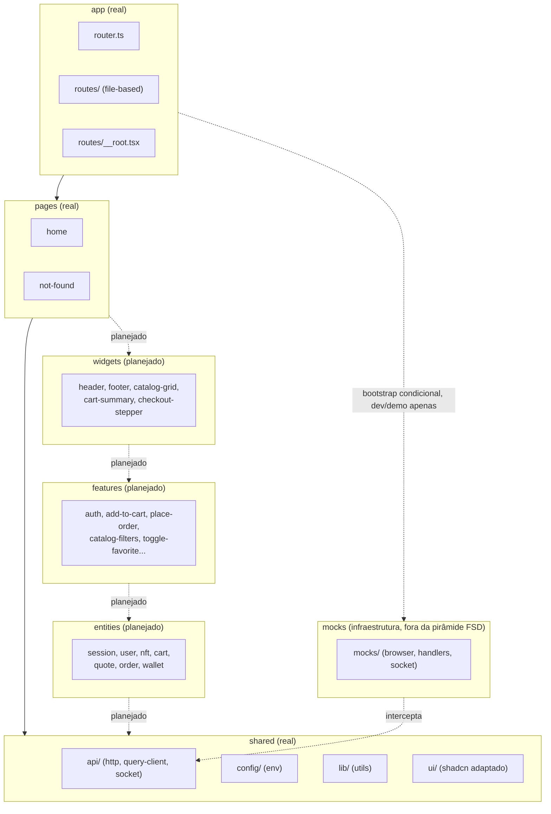

# Arquitetura — Kurio NFT Marketplace

> **Estado atual: Fase 0 — Setup.** Este documento descreve com precisão o que já existe no código hoje e marca como "planejado" o que está no roadmap mas ainda não foi implementado. Decisões futuras devem ser registradas aqui antes de contradizer o que está escrito.

## Visão geral (Feature-Sliced Design)

Camadas: `app → pages → widgets → features → entities → shared`. Uma camada só importa das camadas abaixo dela. `src/mocks/` é infraestrutura de simulação e nunca é importada por código de negócio (`app`, `pages`, `widgets`, `features`, `entities`, `shared`), exceto pelo bootstrap condicional em `src/main.tsx`.

Hoje, as camadas implementadas são `app`, `pages` e `shared`. `widgets`, `features` e `entities` ainda não existem.



## Estrutura real em `src/`

| Caminho                       | Conteúdo                                                                                                                                                                                     |
| ----------------------------- | -------------------------------------------------------------------------------------------------------------------------------------------------------------------------------------------- |
| `app/router.ts`               | `createRouter` do TanStack Router com `routeTree.gen.ts`, contexto `{ queryClient }`, `defaultPreload: 'intent'`, `scrollRestoration: true`.                                                 |
| `app/routes/__root.tsx`       | Rota raiz (`createRootRouteWithContext<{ queryClient }>`), `notFoundComponent` global apontando para `pages/not-found`.                                                                      |
| `app/routes/index.tsx`        | Rota `/`, renderiza `pages/home`.                                                                                                                                                            |
| `app/routeTree.gen.ts`        | Gerado pelo `@tanstack/router-plugin` a partir de `app/routes/`. Não editar manualmente.                                                                                                     |
| `pages/home`                  | Página inicial: `useQuery` chamando `GET /api/health` via Axios.                                                                                                                             |
| `pages/not-found`             | Página de 404 global.                                                                                                                                                                        |
| `shared/api/http.ts`          | Instância única do Axios (`baseURL: env.apiUrl`, `timeout: 10_000`). Ainda sem interceptors de token/erro — planejado para a Fase 3 (sessão).                                                |
| `shared/api/query-client.ts`  | `QueryClient` com `staleTime: 30_000`, `refetchOnWindowFocus: false`, `retry: 1` (queries), `retry: false` (mutations).                                                                      |
| `shared/api/socket/client.ts` | Instância única do `socket.io-client`, `autoConnect: false`, `transports: ['websocket']`. Ainda não é conectada por nenhuma tela em produção — a Home tem a chamada comentada como lembrete. |
| `shared/config/env.ts`        | Leitura tipada de `import.meta.env` (`VITE_API_URL`, `VITE_SOCKET_URL`, `VITE_ENABLE_MOCKS`).                                                                                                |
| `shared/lib/utils.ts`         | Utilitário `cn` (merge de classes).                                                                                                                                                          |
| `shared/ui/*`                 | Componentes shadcn/ui adaptados (button, badge, checkbox, dialog, input, label, radio-group, select, separator, sheet, skeleton, slider, sonner, tabs, textarea).                            |
| `mocks/browser.ts`            | `setupWorker(...restHandlers, ...socketHandlers)`.                                                                                                                                           |
| `mocks/handlers/index.ts`     | Só `GET /api/health`.                                                                                                                                                                        |
| `mocks/socket/index.ts`       | Handler do handshake Socket.IO via `@mswjs/socket.io-binding` (detalhado abaixo).                                                                                                            |

> Observação: existe um `src/components/ui/button.tsx` fora de `shared/ui/`, remanescente da inicialização padrão do CLI `shadcn` (que usa `src/components/ui` por convenção) antes do alias ser ajustado para `@/shared/ui` em `components.json`. O componente usado de fato pela aplicação é `src/shared/ui/button.tsx`. Este arquivo órfão deve ser removido ou migrado na primeira tarefa de UI que tocar botões.

## Contratos REST e eventos

Ainda não há schemas zod em `src/shared/api/contracts/` — **planejado a partir da Fase 1**, quando `mock-engineer` e `feature-dev` definirem os contratos de catálogo, carrinho, pedidos, etc., compartilhados entre handlers MSW, cliente Axios e testes (ver rule `typescript.md`).

O único contrato real hoje é o health check, sem validação zod:

| Método | Rota          | Resposta | Exemplo de payload   |
| ------ | ------------- | -------- | -------------------- |
| `GET`  | `/api/health` | `200 OK` | `{ "status": "ok" }` |

Eventos de Socket.IO: nenhum evento de domínio existe ainda. O único pacote emitido hoje é de infraestrutura do mock (não é um evento de negócio):

| Evento         | Emitido por                              | Payload                                | Propósito                                                                                                                                  |
| -------------- | ---------------------------------------- | -------------------------------------- | ------------------------------------------------------------------------------------------------------------------------------------------ |
| `system.ready` | `src/mocks/socket/index.ts`, ao conectar | `{ "at": "2026-11-03T12:00:00.000Z" }` | Sinaliza que o handshake do mock terminou. Usado só para verificação manual durante o setup; não é consumido por nenhuma tela em produção. |

Os eventos de negócio `nft.updated` e `order.updated` (envelope `{ eventId, resource: { type, id }, version, data, userId? }`, ver rule `realtime-socket.md`) ainda não existem — planejados para as fases de catálogo/tempo real e de pedidos.

## Política de sessão

Ainda não implementada — **planejado para a Fase 3**. Será documentada aqui: mecanismo de token, onde é persistido, interceptor de 401 no Axios, desconexão do socket e limpeza de cache privado do Query no logout/troca de usuário (regra eliminatória nº 4).

## Estado do carrinho (visitante → autenticado)

Ainda não implementado — **planejado para a Fase 6** (`entities/cart`, `features/add-to-cart`). Será documentada aqui a estratégia de persistência do carrinho de visitante (ex.: `localStorage`) e sua migração/merge ao autenticar.

## Estratégia de cache, retries e sincronização

Hoje existe apenas a configuração global do `QueryClient` (`src/shared/api/query-client.ts`):

| Opção                  | Valor       | Efeito                                                                       |
| ---------------------- | ----------- | ---------------------------------------------------------------------------- |
| `staleTime`            | `30_000` ms | Dados de query são considerados frescos por 30s antes de refetch automático. |
| `refetchOnWindowFocus` | `false`     | Não refaz fetch ao focar a janela.                                           |
| `retry` (queries)      | `1`         | Uma tentativa adicional em caso de falha.                                    |
| `retry` (mutations)    | `false`     | Mutations não são retentadas automaticamente.                                |

Política detalhada por tipo de erro (não retentar 4xx, backoff em falhas transitórias, idempotência em `place-order`), query keys com `userId`, `placeholderData: keepPreviousData` em listagens e mutation otimista de favoritos — **planejado**, conforme rule `tanstack-query.md`, a partir das fases de catálogo/pedidos.

## Reconciliação REST × Socket.IO

A infraestrutura de simulação do socket já existe (ver seção seguinte), mas a lógica de reconciliação de negócio — dedupe por `eventId`, descarte de `version` menor ou igual à última aplicada, invalidação/refetch ao reconectar, filtro por `userId`/sessão — ainda não existe. **Planejado** a partir da fase de tempo real (NFTs/pedidos), conforme rule `realtime-socket.md`.

## Transporte do Socket no MSW e limitações

O `socket.io-client` conecta por padrão em `/socket.io/...` (não na raiz do host). O handler `ws.link(...)` do MSW precisa do padrão com wildcard — `'wss://realtime.kurio.local/*'`, não `'wss://realtime.kurio.local'` sem path — porque o matcher HTTP do handshake do MSW não faz strip automático de `/socket.io/` (isso só ocorre depois do upgrade, dentro do `WebSocketHandler` interno). Sem o wildcard, a conexão nunca é reconhecida pelo MSW.

Código atual (`src/mocks/socket/index.ts`):

```ts
import { ws } from 'msw'
import { toSocketIo } from '@mswjs/socket.io-binding'

const realtime = ws.link('wss://realtime.kurio.local/*')

export const socketHandlers = [
  realtime.addEventListener('connection', (connection) => {
    const io = toSocketIo(connection)
    // `toSocketIo` agenda o handshake inicial (pacotes "open"/"connect") via
    // microtask; emitir no mesmo tick entrega o evento fora de ordem e o
    // cliente o descarta. Agendar depois garante a ordem correta.
    queueMicrotask(() => {
      io.client.emit('system.ready', { at: new Date().toISOString() })
    })
  }),
]
```

Limitações conhecidas:

- `toSocketIo(connection)` do `@mswjs/socket.io-binding` agenda os pacotes iniciais do handshake (Engine.IO `open` + Socket.IO `connect`) de forma assíncrona via `queueMicrotask` dentro do próprio construtor. Emitir (`io.client.emit(...)`) sincronamente logo depois entrega o evento customizado antes do handshake, fora de ordem — o `socket.io-client` descarta esse pacote silenciosamente. Qualquer `emit` feito pelos handlers de mock precisa estar dentro de um `queueMicrotask` (a ordem FIFO de microtasks garante que ele rode depois do handshake).
- `msw` está fixado em `^2.15.0` (não v3), porque `@mswjs/socket.io-binding@^0.2.0` declara peer dependency `msw@^2.10.2`, incompatível com MSW v3.
- O binding não é mantido 1:1 com a API real do Socket.IO: não há suporte nativo a rooms, namespaces ou broadcast (conforme o próprio README do pacote). Qualquer funcionalidade avançada de tempo real simulada deve ser testada manualmente contra esse limite, e alternativas (ex.: emitir para todas as conexões abertas manualmente) devem ser documentadas quando usadas.

## Decisões de UX

Nenhuma decisão de UX específica de fluxo foi tomada ainda (não há telas de negócio). Decisões de UI de base já tomadas:

- Fonte única: Roboto Mono (`@fontsource/roboto-mono`), carregada localmente (pesos 400/500/700) em `src/main.tsx`. O CSS (`src/index.css`) também importa `@fontsource-variable/inter` e referencia `'Inter Variable'` como `--font-sans` alternativa — ver seção de desvios abaixo.
- Tema shadcn com `style: "base-vega"` e cores via CSS variables (`src/index.css`), nunca hex solto em componente.

## Estados não desenhados no Figma

Nenhuma tela de negócio foi implementada ainda, então não há estados não desenhados a documentar nesta fase. Esta seção será preenchida conforme `ui-dev` implementar telas e encontrar estados (erro, vazio, loading específico) sem frame correspondente no Figma — devem seguir o mesmo padrão visual dos tokens existentes.

## Desvios e inconsistências do Figma

| Item                                | Figma                                                                                                                                                                                                                     | Implementação atual                                                                                                                                                                                                                                   | Status                                                                                                                                      |
| ----------------------------------- | ------------------------------------------------------------------------------------------------------------------------------------------------------------------------------------------------------------------------- | ----------------------------------------------------------------------------------------------------------------------------------------------------------------------------------------------------------------------------------------------------- | ------------------------------------------------------------------------------------------------------------------------------------------- |
| Cor `destructive`                   | Não existe variável de erro/destrutiva nos tokens do Figma (`design-tokens.md` só define ink, surface-card, surface-dark, border, border-soft, primary, text-accent, secondary, text-primary, foreground, text-secondary) | `--destructive: #e5484d` em `src/index.css`, usando o vermelho padrão do shadcn/Radix                                                                                                                                                                 | Provisório — ver ADR-002                                                                                                                    |
| Fonte secundária (`Inter Variable`) | `design-tokens.md` especifica Roboto Mono como fonte única do produto                                                                                                                                                     | `src/index.css` importa `@fontsource-variable/inter` e define `--font-sans: 'Inter Variable', sans-serif` depois de já ter definido `--font-sans` com Roboto Mono (a segunda declaração sobrescreve a primeira dentro do mesmo bloco `@theme inline`) | A confirmar — possível resíduo do template shadcn/Vite, não documentado como decisão; revisar na primeira tarefa de UI que tocar tipografia |

## Substituições de assets

Nenhuma substituição de asset de produto foi feita ainda (não há telas de catálogo/NFT implementadas). `src/assets/hero.png`, `react.svg` e `vite.svg` são placeholders do template inicial do Vite, usados apenas em `App.tsx` (componente de boilerplate, não roteado — a aplicação real renderiza `pages/home`, não `App.tsx`). Serão substituídos/removidos quando as telas reais de catálogo/home forem implementadas a partir do Figma.

## Ajustes de acessibilidade

Nenhum ajuste de acessibilidade específico de tela foi feito ainda. Bases já presentes no projeto:

- `eslint-plugin-jsx-a11y` ativo no `lint`.
- Tema shadcn com variáveis de foco (`--ring`) herdadas pelos componentes de `shared/ui`.

Ajustes específicos (labels, `aria-describedby`, focus trap em Dialog/Sheet, `aria-live`, estados não dependentes só de cor) serão documentados aqui conforme implementados, por `ui-dev`/`quality-auditor`.

## ADRs

### ADR-001 — Transporte do Socket.IO no MSW: wildcard no path e `emit` após microtask

- **Contexto**: `socket.io-client` sempre conecta em `/socket.io/...`, não na raiz do host informado em `VITE_SOCKET_URL`. O handler `ws.link('wss://realtime.kurio.local')` (sem wildcard) nunca reconhecia a conexão, porque o matcher de handshake do MSW não faz strip de path antes do upgrade.
- **Decisão**: usar `ws.link('wss://realtime.kurio.local/*')` (com wildcard) e envolver todo `emit` feito por handlers de mock em `queueMicrotask(() => ...)`, para rodar depois do handshake assíncrono agendado internamente por `toSocketIo`.
- **Consequências**: handshake e eventos chegam na ordem correta ao `socket.io-client`. `msw` fica fixado em `^2.15.0` (não v3) por peer dependency de `@mswjs/socket.io-binding@^0.2.0`. O binding não suporta rooms/namespaces/broadcast nativamente — funcionalidades avançadas de tempo real exigem verificação manual.

### ADR-002 — Cor `--destructive` provisória, ausente no Figma

- **Contexto**: o Figma do desafio (fileKey `TWDGE5ytlsmMSUk7jX50Hw`) e `design-tokens.md` não definem nenhum token de cor de erro/destrutiva.
- **Decisão**: usar o vermelho convencional do shadcn/Radix (`#e5484d`) como `--destructive` em `src/index.css`, por ser o valor padrão desse design system e manter o mesmo padrão tonal (HSL na mesma faixa escura dos demais tokens do tema).
- **Consequências**: qualquer estado de erro visual (toast de erro, borda de input inválido, badge de recusado) usará esse vermelho até validação. O valor é **provisório** e deve ser confirmado com o time de design/Figma antes de ser usado em telas finais de erro — se o Figma vier a definir um token oficial, esta cor deve ser substituída e este ADR atualizado.
